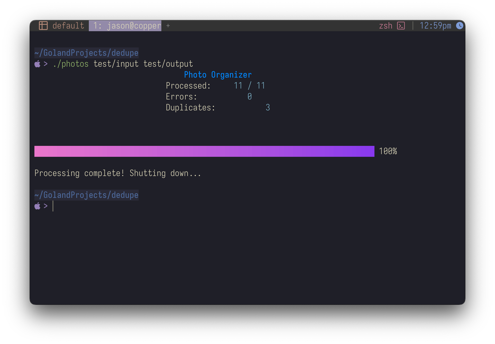

+++
date = '2026-10-22T09:01:00-04:00'
draft = false
title = 'dedupe'
status = 'paused'
github = 'https://github.com/shurikai/dedupe'
description = 'A Go CLI that organized and deduplicated 20+ years of family photos and videos.'
summary = 'A Go CLI that organized and deduplicated 20+ years of family photos and videos.'
tags = ['go']
weight = 3
+++

**Repo:** [github.com/shurikai/dedupe](https://github.com/shurikai/dedupe)  
**Stack:** Go, Charm (`bubbletea`, `bubbles`, `lipgloss`), `net/http`

## Why I built it

Two decades of family photos and videos had piled up across drives and backups: well over 100,000 files,
many of them stored more than once. I wanted them sorted and deduplicated, and I wanted a real project
to get current with modern Go.

## What it does

Three subcommands cover the workflow:

```
dedupe organize  -->  dedupe review  -->  dedupe clean
   (sort files)       (pick keepers)      (apply decisions)
```

- **organize** walks a directory, reads creation dates from EXIF or video metadata, and files everything
  into `year/month/day` folders. Duplicates are detected by content hash, and files with no date go to
  their own folder. It copies by default, so the originals stay put.
- **review** starts a small local web server and opens a side-by-side view of each duplicate pair, with
  keyboard shortcuts for keep or delete. Decisions are saved as you go, so you can stop and pick up later.
- **clean** applies those decisions. It's a dry run unless you pass `--execute`.



## What I learned

- **Concurrency in practice:** a goroutine worker pool that keeps every core busy hashing and reading
  metadata
- **Terminal UIs with Charm:** a live, multi-component progress display built with `bubbletea`
- **Safety as a feature:** copy instead of move, dry-run deletes, and a review step between detection and
  deletion. With family photos, the cost of a mistake is permanent.
- **Small, dependency-free web UI:** the review page is one embedded HTML file with vanilla JS and no
  build step, and the server only serves files that are in the pair list
